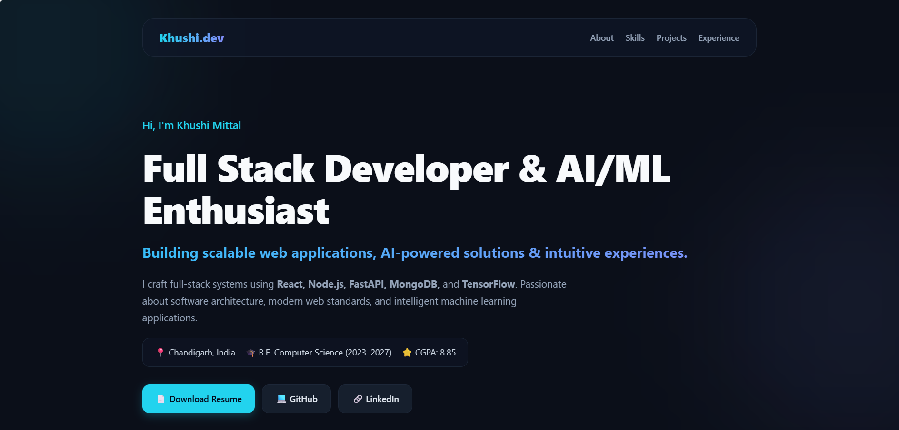

# 🌐 Personal Portfolio

A modern and responsive portfolio website showcasing my skills, projects, experience, and journey as a Computer Science Engineering student and Full Stack Developer.

## ✨ Features

- 👤 Personal introduction and developer profile
- 🚀 Projects showcase
- 🛠️ Skills and technologies section
- 📄 Resume integration
- 📱 Fully responsive design
- 🌙 Modern UI with smooth animations
- 📬 Contact section

## 🛠️ Tech Stack

### Frontend
- React.js
- JavaScript
- HTML5
- CSS3
- Bootstrap / Tailwind CSS

### Tools
- Git
- GitHub
- VS Code


## 📸 Screenshots

<div align="center">



</div>

## 🚀 Getting Started

Clone the repository:

```bash
git clone https://github.com/khushi519g5/portfolio.git


Install dependencies:

npm install


Run the project:

npm start
